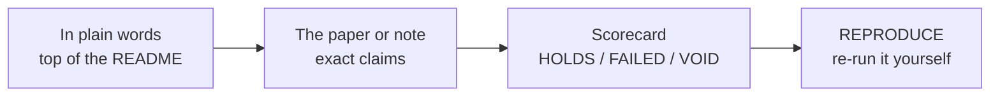

# Moki & Julio

**A small independent lab that proves, measures and checks things, from black holes to the history of our species. Each
project ships its code and data, and says plainly what was and was not shown.**

Moki & Julio (AI-assisted) · text and data CC BY 4.0, code MIT, unless a repository says otherwise

## The story in a minute

We do computational research: proofs a computer can check, measurements of real devices, and very long, very precise
calculations. Each project below can be checked or re-run by anyone.

A picture that helps: a kitchen where every dish arrives with its recipe, the shopping list, and a note on what burned.
Where the picture breaks: tasting a dish is not proving it. Some of our results are proofs that an independent checker
program verifies. Others are measurements of one device, or simulations. Each repository says which.

Two habits run through all of it. First, where we can, we write a prediction down and hash it **before** the answer
exists, and a separate seat computes the answer without seeing the prediction. Second, failures stay on the page, marked
FAILED, next to the results that held.

## The map of the lab

Pick the door that draws you. Each line is one project's plain hook; the repository climbs from there.

### Puzzles and shapes

- [**szilassi-12**](https://github.com/Hashirama1337s/szilassi-12) - Szilassi's polyhedron is a ring of seven hexagons in
  which every face touches every other. We proved that such a ring (without "overarching" faces) always has exactly one
  un-dented face, and that the
  next possible solid of this kind, with twelve faces, cannot have any symmetry. Each "impossible" comes with a proof file
  an independent checker reads.
- [**moki-julio-circle-packing**](https://github.com/Hashirama1337s/moki-julio-circle-packing) - How tightly can equal
  circles, spheres and higher-dimensional balls be packed? 6,071 record packings published, each verified by two
  independently written exact checkers; others have since beaten or tied 2,008 of them, and 4,063 were still best-known
  on 2026-10-18.

### Chaos you can prove

- [**ueda-chaos**](https://github.com/Hashirama1337s/ueda-chaos) - A damped spring with a cubic restoring force, pushed
  back and forth, x'' + 0.05x' + x^3 = 7.5 cos t: called chaotic for decades on the strength of simulations, now proved
  chaotic with two independently written rigorous checkers.
- [**rikitake-chaos**](https://github.com/Hashirama1337s/rikitake-chaos) - Two spinning copper discs, Rikitake's 1958
  model of a planet's magnetic field flipping, proved chaotic for three parameter values.
- [**laser-chaos**](https://github.com/Hashirama1337s/laser-chaos) - The CO2-laser chaos model (a loss-modulated
  class-B laser) provably contains a chaotic set of motions. In long simulations at the same parameters the laser settles
  into a rhythm that repeats every 16 modulation periods, so the chaos is real but hidden (the rhythm is a numerical
  observation, not proved).

### Black holes and extra dimensions

- [**large-d-gregory-laflamme**](https://github.com/Hashirama1337s/large-d-gregory-laflamme) - The exact recipe for when
  a stretched black hole (a black string) starts to break apart, pushed from five terms to thirteen. Those 13 exact terms
  plus 38 computed numerically (51 in all), summed the right way and read through a mathematical mirror, predicted how a
  hot holographic plasma screens a disturbance to about 15 digits.
- [**airy-edge-hydrodynamics**](https://github.com/Hashirama1337s/airy-edge-hydrodynamics) - Fluid equations describe a
  holographic plasma only up to a certain momentum. Followed from three to 32768 dimensions, that limit creeps towards a
  fixed point as one over the cube root of d, with a coefficient from the Airy function (formal, no error bounds). A model
  built from it matched the computed values at d = 8192-32768; the repository explains why that test is not fully blind
  (the answers were already on disk), so it rests on the theory seat's word.

### Numbers and Ramanujan

- [**ramanujan-septic-galois**](https://github.com/Hashirama1337s/ramanujan-septic-galois) - On page 206 of his lost
  notebook Ramanujan left three pieces of a formula blank; Rebák filled them in in 2023. The same split exists at every
  odd prime; we found the pieces at 11 and 13, computed them for every prime below 100, and proved the rules that govern
  them.
- [**debruijn-newman-degree-two**](https://github.com/Hashirama1337s/debruijn-newman-degree-two) - Every L-function has a
  "heat dial" that pushes its zeros onto one line. We proved the dial never needs to go past 0.449938 for the modular
  form eta(z)eta(23z), where classical theory gives 1/2; we found no earlier bound below 1/2 in degree 2. Nothing here
  bears on the Riemann hypothesis itself.

### Quantum systems and their parts

- [**moment-map-local-maxima**](https://github.com/Hashirama1337s/moment-map-local-maxima) - A quantum system does not come
  with built-in parts. Which ways of splitting it make the parts interact least? For a simple spectrum, an exact
  classification with complete proofs, which also explains class counts McConnell and Jennings had computed numerically;
  degenerate spectra stay open.
- [**certified-qubit-peel**](https://github.com/Hashirama1337s/certified-qubit-peel) - A published method builds qubits
  out of a list of energies. Re-run with its authors' own notebook and checked against certified best splits: its first
  qubit scores about twice as badly as the best (+101 %), while its headline "of the order of a percent" holds up (2.88 %).

### Measuring real devices

- [**kinect-v1-depth-levels**](https://github.com/Hashirama1337s/kinect-v1-depth-levels) - Our Xbox 360 Kinect cannot
  report just any distance: between 1 and 4 metres it has exactly 259 possible answers, all on one published table. Also
  three kinds of noisy pixel, warm-up drift, and a map of what the hardware can and cannot do.
- [**moki-julio-wifi-ris-cell**](https://github.com/Hashirama1337s/moki-julio-wifi-ris-cell) - A "smart mirror" for
  Wi-Fi: one 15 mm cell whose single 1-bit switch state covers 2.4 GHz and the full 5.15-7.125 GHz span. Simulation only;
  nothing has been built or measured.

### The history of our species

- [**human-catalog**](https://github.com/Hashirama1337s/human-catalog) - A parts catalog for human history: drill from era
  to span to year to part, from about 7 million years ago to 2026. 873 parts each checked against its source, 24,117
  people, 96 unsung heroes, 46 open questions. [Open the catalog](https://hashirama1337s.github.io/human-catalog/).

## How to read any of our repositories

The status words mean the same thing everywhere. **HOLDS**: passed a bar written before the data. **FAILED**: did not,
and stays on the page. **VOID** or **NO VERDICT**: the test could not decide. **RETRACTED**: we withdrew it, and say why.

## Use it as a tool

| If you want to... | Start here |
|---|---|
| explore history by clicking, no install | [the Human Catalog](https://hashirama1337s.github.io/human-catalog/) |
| check a computer-assisted proof yourself | [szilassi-12](https://github.com/Hashirama1337s/szilassi-12), [ueda-chaos](https://github.com/Hashirama1337s/ueda-chaos), [rikitake-chaos](https://github.com/Hashirama1337s/rikitake-chaos), [laser-chaos](https://github.com/Hashirama1337s/laser-chaos) |
| use record packings and their exact certificates | [moki-julio-circle-packing](https://github.com/Hashirama1337s/moki-julio-circle-packing) |
| compute a screening mass of the AdS black brane at your own d | [large-d-gregory-laflamme](https://github.com/Hashirama1337s/large-d-gregory-laflamme) (Python + mpmath, seconds) |
| test your own Kinect, or check its depth table without one | [kinect-v1-depth-levels](https://github.com/Hashirama1337s/kinect-v1-depth-levels) |

Each repository lists its exact commands and expected outputs, and most carry a DOI so you can cite the version you used.

## What we do not claim

- Several proofs were checked by independent AI reviewers and **not yet by a human expert** (for example
  ramanujan-septic-galois and debruijn-newman-degree-two). That reading is the real bar, and we ask for it.
- "We found no earlier ..." is a search floor (a dated search of named sources), not a clearance.
- Records can fall: circle-packing lists every packing others have since beaten or tied.
- The Wi-Fi cell is a simulation study; the Kinect results are one unit, one operator.

## Words you will meet

- **Computer-assisted proof** - a proof in which a computer does an exhaustive search or rigorously bounded arithmetic
  that anyone can re-run.
- **Independent checker** - a second, separately written program that verifies the same proof or certificate.
- **Certificate** - a file that lets a checker confirm a result without redoing the search.
- **Sealed test** - a prediction and pass bar hashed before the data exist.
- **Blind seat** - a separately briefed computation that cannot see the prediction it is scoring.
- **Search floor** - the dated list of sources we searched before saying something looked new.
- **DOI** - a permanent link to an archived, citable version.
- **L-function** - a function in the family of the Riemann zeta function; each has a degree (zeta itself is degree 1)
  and zeros whose positions carry number-theoretic information.
- **Modular form** - a highly symmetric function; eta(z)eta(23z) is one, and it has its own L-function of degree 2.
- **Holographic plasma** - a hot plasma modelled by a black hole with a flat horizon (an AdS black brane) in a space with
  one extra dimension.
- **Class-B laser** - a laser described by two rate equations, one for the light intensity and one for the population
  inversion.

---

## For specialists: the original README

Kept verbatim as it stood on 2026-11-07. Where it differs from the project pages, the project pages and the map above
are current: human-catalog now lists 24,117 people; circle-packing lists 4,063 of its 6,071 released records as still
best-known; laser-chaos calls the period-16 rhythm a numerical observation, not proved; and airy-edge-hydrodynamics
explains that its "blind" prediction rests on the theory seat's word, because the computed answers were already on disk.

# Moki & Julio

Independent computational research. Every project ships its code and data, says plainly what was and was not shown,
and can be checked or re-run by anyone. Newest first.

| Project | What it is | Archive |
|---|---|---|
| [human-catalog](https://github.com/Hashirama1337s/human-catalog) | A parts catalog for the history of our species: zoom from era to span to year to part, 7 million years ago to 2026; 873 parts each checked against its source, 24,057 people with real dates, 96 unsung heroes, 46 open questions humanity has not answered, a migration map and two games | [doi:10.5281/zenodo.23977246](https://doi.org/10.5281/zenodo.23977246) |
| [airy-edge-hydrodynamics](https://github.com/Hashirama1337s/airy-edge-hydrodynamics) | Where fluid predictions for a holographic plasma stop working: the edge approaches a fixed point as d^(-1/3) with an Airy-function coefficient, predicted blind at d = 8192-32768 and checked to be the nearest obstacle at d = 512, 1024 and 8192 | [doi:10.5281/zenodo.23942230](https://doi.org/10.5281/zenodo.23942230) |
| [large-d-gregory-laflamme](https://github.com/Hashirama1337s/large-d-gregory-laflamme) | The point where a black string cracks, as an exact large-dimension series to order 1/n^12 (multiple zeta values incl. zeta(5,3), zeta(3,5,3)), resummed to predict AdS plasma screening masses to 15+ digits | [doi:10.5281/zenodo.23940227](https://doi.org/10.5281/zenodo.23940227) |
| [debruijn-newman-degree-two](https://github.com/Hashirama1337s/debruijn-newman-degree-two) | Proven de Bruijn-Newman bounds below 1/2 in degree 2 (eta(z)eta(23z): 0.449938; none earlier found), and a product lemma giving such bounds for Dedekind zeta functions | [doi:10.5281/zenodo.23794434](https://doi.org/10.5281/zenodo.23794434) |
| [ramanujan-septic-galois](https://github.com/Hashirama1337s/ramanujan-septic-galois) | Ramanujan's lost-notebook septic identity at every odd prime: the number fields of its pieces, one rule (Euler's idoneal numbers) for when they are cyclotomic at every odd level, units and a Stark-unit recipe | [doi:10.5281/zenodo.23790016](https://doi.org/10.5281/zenodo.23790016) |
| [laser-chaos](https://github.com/Hashirama1337s/laser-chaos) | Computer-assisted proof that the loss-modulated class-B laser (the CO2-laser chaos model) has a chaotic set of motions; at the published parameters the long-run behaviour is a period-16 rhythm, so the chaos is real but hidden | [doi:10.5281/zenodo.23422903](https://doi.org/10.5281/zenodo.23422903) |
| [certified-qubit-peel](https://github.com/Hashirama1337s/certified-qubit-peel) | A published method that builds qubits out of a list of energies, re-run with its authors' own code and checked against certified best splits: where its search misses, by how much, and what survives | [doi:10.5281/zenodo.23293218](https://doi.org/10.5281/zenodo.23293218) |
| [moment-map-local-maxima](https://github.com/Hashirama1337s/moment-map-local-maxima) | Which ways of splitting a quantum system into parts make the parts interact least: an exact classification (theorem with complete proofs), extended to mutual information, explaining the McConnell-Jennings counts | [doi:10.5281/zenodo.23275890](https://doi.org/10.5281/zenodo.23275890) |
| [ueda-chaos](https://github.com/Hashirama1337s/ueda-chaos) | Computer-assisted proof that Ueda's forced oscillator x'' + 0.05x' + x^3 = 7.5 cos t is chaotic | [doi:10.5281/zenodo.23172757](https://doi.org/10.5281/zenodo.23172757) |
| [moki-julio-wifi-ris-cell](https://github.com/Hashirama1337s/moki-julio-wifi-ris-cell) | One 1-bit reconfigurable-intelligent-surface cell covering the 2.4 GHz and 5-7 GHz Wi-Fi bands with one switch state (simulation study, Palace FEM) | [doi:10.5281/zenodo.23165406](https://doi.org/10.5281/zenodo.23165406) |
| [rikitake-chaos](https://github.com/Hashirama1337s/rikitake-chaos) | Computer-assisted proof that Rikitake's two-disc dynamo (1958) is chaotic | [doi:10.5281/zenodo.23041182](https://doi.org/10.5281/zenodo.23041182) |
| [szilassi-12](https://github.com/Hashirama1337s/szilassi-12) | No symmetric 12-face Szilassi polyhedron: a computer-assisted proof with DRAT certificates | [doi:10.5281/zenodo.23003257](https://doi.org/10.5281/zenodo.23003257) |
| [moki-julio-circle-packing](https://github.com/Hashirama1337s/moki-julio-circle-packing) | 6,071 new best-known packings of equal circles, spheres and hyperspheres, each verified by two independent exact checkers | [doi:10.5281/zenodo.22981305](https://doi.org/10.5281/zenodo.22981305) |
| [kinect-v1-depth-levels](https://github.com/Hashirama1337s/kinect-v1-depth-levels) | The Xbox 360 Kinect measured as an instrument: the depth lattice, three noise populations, drift and a capability map | GitHub only |

Text and data are CC BY 4.0 and code is MIT unless a repository says otherwise.
