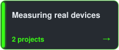
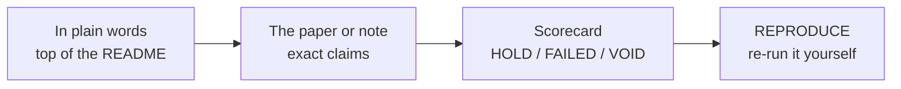

# Moki & Julio

**A small independent lab that proves, measures and checks things, from black holes to prime numbers to real devices.
Each project ships its code and data, and says plainly what was and was not shown.**

 

Seven doors, twenty-four projects. Click a door to jump to its projects.

Moki & Julio · text and data CC BY 4.0, code MIT, unless a repository says otherwise

## In plain words

We do computational research: proofs a computer can check, measurements of real devices, and very long, very precise
calculations. Each project below can be checked or re-run by anyone.

 **The idea in one picture.** A kitchen where every dish arrives with its recipe, the shopping list, and a note on what burned.
**Where the picture breaks.** Tasting a dish is not proving it. Some of our results are proofs that an independent checker
program verifies. Others are measurements of one device, or simulations. Each repository says which.

Two habits run through all of it. First, where we can, we write a prediction down and hash it **before** the answer
exists, and a separate seat computes the answer without seeing the prediction. Second, failures stay on the page, marked
FAILED, next to the results that held.

## Newest

**[certified-memory-channels](https://github.com/Hashirama1337s/certified-memory-channels)** (November 2026, v1.0). How many bits per use can you send through a
channel that remembers your last symbol? For three classic binary channels with memory (the dicode erasure channel,
and the erasure and flip channels whose inputs may never contain two 1s in a row) nobody knows exactly. This release
gives proven floors and ceilings at five noise levels each: windows as narrow as 8.1e-13 bits per use, where the
published proven ranges we compared with are a few ten-thousandths to a few hundredths wide. Every ceiling ships as a
certificate you can re-check in seconds; an independent second implementation agrees at the three standard points.
The methods are standard and credited; four FAILED sealed tests and one VOID are kept on the scorecard; internal AI
referees, not external peer review.
[doi:10.5281/zenodo.24472620](https://doi.org/10.5281/zenodo.24472620)

**[certified-trapdoor-channel](https://github.com/Hashirama1337s/certified-trapdoor-channel)** (November 2026, v1.0). A box holds one ball; you drop a ball in and one of the
two falls out at random. How many bits per drop can you get across to someone watching? David Blackwell asked in 1961,
and the best proven answer we could find in print was "between 0.5 and 0.585". This release proves
0.5749319 ≤ C ≤ 0.5749683: a gap of 0.0000363, about 2,300 times narrower than that interval. The floor is one
explicit input recipe whose information rate is computed with every rounding error bounded; the ceiling is a model of
the falling balls checked with a published duality bound, every case rounded upward. The duality method and the order-k
shortcut's special case are others' published work, credited; two FAILED sealed tests and one VOID are kept on the
scorecard; internal AI referees, not external peer review.
[doi:10.5281/zenodo.24443961](https://doi.org/10.5281/zenodo.24443961)

**[conic-records](https://github.com/Hashirama1337s/conic-records)** (November 2026, v1.0). A smooth surface of degree 4 can hold at most 800 conics
(ellipses, parabolas, hyperbolas lying inside it), and Degtyarev described the record-holders by lattice data alone. In
1994 Barth and Bauer proved that some of these surfaces exist and wrote that they did not find their equations. This
release writes down six record surfaces, with 656, 664, 704, 736, 660 and 640 conics. One of them is the real record: all
656 conics are real curves you could draw. Every conic is written out exactly, and a lattice argument proves no more
conics hide anywhere. The surfaces' existence and lattice data are Degtyarev's, the families are classical, all credited;
internal AI referees, not external peer review. [Spin the 656 surface in 3-D](https://hashirama1337s.github.io/y56-atlas/viewer/).
[doi:10.5281/zenodo.24413371](https://doi.org/10.5281/zenodo.24413371)

**[y56-atlas](https://github.com/Hashirama1337s/y56-atlas)** (November 2026, v1.0). A smooth curved surface of degree 4 can hold at most
 56 real straight lines, and exactly one surface does it: Y56, found by Degtyarev, Itenberg and Sertöz. This atlas
writes out everything it carries, exactly (all 56 lines, its 188 conics, its 32 symmetries), then turns one dial in
its equation: 40 lines ride along the whole family, and 16 lines exist only at the single setting where
2s4 = 81, which is Y56 itself, because three equations in two unknowns agree only there. 524 theorems are
checked in Lean, three internal referee rounds re-derived the rest, and an interactive 3-D viewer ships with it: [spin Y56 in your browser](https://hashirama1337s.github.io/y56-atlas/viewer/).
The surface, its line count and its symmetry count are others' published work, credited; internal AI referees,
not external peer review.
[doi:10.5281/zenodo.24406738](https://doi.org/10.5281/zenodo.24406738)

## The map of the lab

Pick the door that draws you. Each line is one project's plain hook; the repository climbs from there.

### Puzzles and shapes

- [**conic-records**](https://github.com/Hashirama1337s/conic-records) - Equations for six record surfaces that a 1994 paper proved exist without writing them down,
  including the real record: one surface carrying 656 real conics. Every conic exact, every count proved exact.
- [**y56-atlas**](https://github.com/Hashirama1337s/y56-atlas) - The one surface with the most real straight lines, 56, written out completely and exactly.
  Turn one dial in its equation and 16 of the lines vanish at once: they exist only where 2s4 = 81. Lean-checked
  core, every computer transcript, and a [3-D viewer you can spin](https://hashirama1337s.github.io/y56-atlas/viewer/) in your browser.
- [**szilassi-12**](https://github.com/Hashirama1337s/szilassi-12) - Szilassi's polyhedron is a ring of seven hexagons in
  which every face touches every other. We proved that such a ring (without "overarching" faces) always has exactly one
  un-dented face, and that the
  next possible solid of this kind, with twelve faces, cannot have any symmetry. Each "impossible" comes with a proof file
  an independent checker reads.
- [**moki-julio-circle-packing**](https://github.com/Hashirama1337s/moki-julio-circle-packing) - How tightly can equal
  circles, spheres and higher-dimensional balls be packed? 6,071 record packings published, each verified by two
  independently written exact checkers; others have since beaten or tied 2,008 of them, and 4,063 were still best-known
  on 2026-10-18.

### Chaos you can prove

- [**ueda-chaos**](https://github.com/Hashirama1337s/ueda-chaos) - A damped spring with a cubic restoring force, pushed
  back and forth, x'' + 0.05x' + x^3 = 7.5 cos t: called chaotic for decades on the strength of simulations, now proved
  chaotic with two independently written rigorous checkers.
- [**rikitake-chaos**](https://github.com/Hashirama1337s/rikitake-chaos) - Two spinning copper discs, Rikitake's 1958
  model of a planet's magnetic field flipping, proved chaotic for three parameter values.
- [**laser-chaos**](https://github.com/Hashirama1337s/laser-chaos) - The CO2-laser chaos model (a loss-modulated
  class-B laser) provably contains a chaotic set of motions. In long simulations at the same parameters the laser settles
  into a rhythm that repeats every 16 modulation periods, so the chaos is real but hidden (the rhythm is a numerical
  observation, not proved).

### Gravity and black holes

- [**certified-dark-core**](https://github.com/Hashirama1337s/certified-dark-core) - Can a hollow-shell ball of dark matter
  be stable? Certified linear stability of the one-node Gross-Pitaevskii-Poisson state for every central amplitude in
  [1.597, 1.983], with certified growing modes at 1.595 and 1.985 (computer-assisted; internal referees, an
  independent checker and a blind float replication, not external peer review).
- [**certified-quantum-ball**](https://github.com/Hashirama1337s/certified-quantum-ball) - Which way does the quantum world push a
  ball of light? A certified one-loop quantum source on the Evans-Coleman critical solution, and the sign of its push on
  the peak compactness: Ψ2 = 3.4616358037141656915 ± 3.02e-12, toward trapping (computer-assisted; conditional on a
  self-similar quantum state; internal checks and a blind replication, not external peer review).
- [**certified-page-time**](https://github.com/Hashirama1337s/certified-page-time) - When does a black hole stop being a one-way door? Certified entropy ratio
  β = 1.4846916919 ± 7.81e-11 and Page time 0.5381024532 ± 8.99e-11 of its life, for a Schwarzschild black hole emitting
  photons and gravitons (computer-assisted; internal checks and a blind replication, not external peer review).
- [**certified-evans-coleman**](https://github.com/Hashirama1337s/certified-evans-coleman) - Does the ball of light exist, and how many ways can
  it fall? A computer proof that the Evans-Coleman critical solution of radiation collapse exists and has exactly
  one growing spherical mode, with γ in [0.3558019224 ± 6.97e-11] (computer-assisted; internal checks, not external
  peer review).
- [**certified-bowen-york-spin**](https://github.com/Hashirama1337s/certified-bowen-york-spin) - How fast can a
  Bowen-York black hole spin? A computer proof that the ceiling of J/M² lies in [0.9282004538, 0.9282004687], and the
  limiting throat's own spin to about 11 digits; plus hand proofs that the mass is convex in the bare mass and that the
  limiting throat has no horizon (computer-assisted where stated; internal checks, not external peer review).
- [**certified-kummer-k3**](https://github.com/Hashirama1337s/certified-kummer-k3) - The perfect geometry of a K3
  surface, string theory's hidden four dimensions, pinned between two copies of an explicit glued formula: a computer
  proof, for every patch size up to 0.03, that they differ by at most 0.29 percent at size 0.01 and 12.2 percent at 0.03
  (conditional on a floating-point assumption and cited standard facts).
- [**certified-chen-lebrun-weber**](https://github.com/Hashirama1337s/certified-chen-lebrun-weber) - A gravitational
  instanton that exists only as a theorem, now located by computer: an explicit approximation, and a proof that the true
  Einstein metric lies within about 5.5 parts in 100 million of it (conditional on cited results). Ships the code, the
  certified data, and every sealed test, failures included.
- [**large-d-gregory-laflamme**](https://github.com/Hashirama1337s/large-d-gregory-laflamme) - The exact recipe for when
  a stretched black hole (a black string) starts to break apart, pushed from five terms to thirteen. Those 13 exact terms
  plus 38 computed numerically (51 in all), summed the right way and read through a mathematical mirror, predicted how a
  hot holographic plasma screens a disturbance to about 9 and 15 digits at two untuned dimensions.
- [**airy-edge-hydrodynamics**](https://github.com/Hashirama1337s/airy-edge-hydrodynamics) - Fluid equations describe a
  holographic plasma only up to a certain momentum. Followed from three to 32768 dimensions, that limit creeps towards a
  fixed point as one over the cube root of d, with a coefficient from the Airy function (formal, no error bounds). A model
  built from it matched the computed values at d = 8192-32768; the repository explains why that test is not fully blind
  (the answers were already on disk), so it rests on the theory seat's word.

### Numbers and Ramanujan

- [**ramanujan-septic-galois**](https://github.com/Hashirama1337s/ramanujan-septic-galois) - On page 206 of his lost
  notebook Ramanujan left three pieces of a formula blank; Rebák filled them in in 2023. The same split exists at every
  odd prime; we found the pieces at 11 and 13, computed them for every prime below 100, and proved most of the rules that govern
  them.
- [**debruijn-newman-degree-two**](https://github.com/Hashirama1337s/debruijn-newman-degree-two) - Every L-function has a
  "heat dial" that pushes its zeros onto one line. We proved the dial never needs to go past 0.449938 for the modular
  form eta(z)eta(23z), where classical theory gives 1/2; we found no earlier bound below 1/2 in degree 2. Nothing here
  bears on the Riemann hypothesis itself.

### Quantum systems and their parts

- [**moment-map-local-maxima**](https://github.com/Hashirama1337s/moment-map-local-maxima) - A quantum system does not come
  with built-in parts. Which ways of splitting it make the parts interact least? For a simple spectrum, an exact
  classification with complete proofs, which also explains class counts McConnell and Jennings had computed numerically;
  degenerate spectra stay open.
- [**certified-qubit-peel**](https://github.com/Hashirama1337s/certified-qubit-peel) - A published method builds qubits
  out of a list of energies. Re-run with its authors' own notebook and checked against certified best splits: its first
  qubit scores about twice as badly as the best (+101 %), while its headline "of the order of a percent" holds up (2.88 %).

### Information and codes

- [**certified-memory-channels**](https://github.com/Hashirama1337s/certified-memory-channels) - Three classic channels that remember your last symbol, each at five
  noise levels: proven floors and ceilings on how much gets through, some pinned to a trillionth of a bit; where the true
  value sits inside each window stays open.
- [**certified-trapdoor-channel**](https://github.com/Hashirama1337s/certified-trapdoor-channel) - Drop a ball into a box that holds one, and one of the two falls out at
  random: how much can you say that way? Blackwell's 1961 question, now pinned to 0.5749319 ≤ C ≤ 0.5749683 bits per
  drop, both ends certified and re-checked by independent programs; where C sits inside the gap stays open.

### Measuring real devices

- [**kinect-v1-depth-levels**](https://github.com/Hashirama1337s/kinect-v1-depth-levels) - Our Xbox 360 Kinect cannot
  report just any distance: between 1 and 4 metres it has exactly 259 possible answers, all on one published table. Also
  three kinds of noisy pixel, warm-up drift, and a map of what the hardware can and cannot do.
- [**moki-julio-wifi-ris-cell**](https://github.com/Hashirama1337s/moki-julio-wifi-ris-cell) - A "smart mirror" for
  Wi-Fi: one 15 mm cell whose single 1-bit switch state serves 2.4 GHz and the full 5.15-7.125 GHz span, meeting a 2 dB loss budget at every simulated angle but one, with the strict phase target met only in part. Simulation only;
  nothing has been built or measured.

## How to read any of our repositories

The status words mean the same thing everywhere.

| | Meaning |
|---|---|
|  | passed a bar written before the data (older pages print HOLDS) |
|  | did not pass, and stays on the page |
|   | the test could not decide |
|  | we withdrew it, and say why |

## Where to start

| If you want to... | Start here |
|---|---|
| re-check the certified capacity windows of three channels with memory | [certified-memory-channels](https://github.com/Hashirama1337s/certified-memory-channels) (Python with numpy, scipy and python-flint; a ceiling certificate in seconds, a floor in about a minute) |
| re-check the certified bounds on Blackwell's trapdoor channel | [certified-trapdoor-channel](https://github.com/Hashirama1337s/certified-trapdoor-channel) (Python with numpy and python-flint; the ceiling in under a second, the full floor in about 25 minutes) |
| check the equations and exact conic counts of six record quartic surfaces | [conic-records](https://github.com/Hashirama1337s/conic-records) (PARI/GP for the lattice proofs, seconds each; Singular, msolve and python-flint for the rest) |
| check every line, conic and symmetry of the 56-line surface, or spin it in 3-D | [y56-atlas](https://github.com/Hashirama1337s/y56-atlas) (Python + sympy, one command, about 2 minutes; Lean 4 + Mathlib for the 524 theorems; a browser for the viewer) |
| re-run a certified stability proof for a dark-matter core | [certified-dark-core](https://github.com/Hashirama1337s/certified-dark-core) (Python + python-flint; the quick checks take minutes, one certified point about 10-30 minutes) |
| re-run a certified quantum push on a critical collapse | [certified-quantum-ball](https://github.com/Hashirama1337s/certified-quantum-ball) (Python + python-flint; the quick tier takes about 20 minutes, the full replay about 7 hours) |
| re-run a certified Hawking-radiation calculation | [certified-page-time](https://github.com/Hashirama1337s/certified-page-time) (Python + python-flint; the quick tier takes about a minute, the full replay about 13 minutes) |
| re-run a certified count of the ways a collapse can fall | [certified-evans-coleman](https://github.com/Hashirama1337s/certified-evans-coleman) (Python + python-flint; the quick tier takes about 20 minutes, the full replay about 5 hours) |
| re-run a certified black-hole spin bound | [certified-bowen-york-spin](https://github.com/Hashirama1337s/certified-bowen-york-spin) (Python + python-flint; the fast checks take minutes, the full sixth-digit run about 30 minutes) |
| re-run a certified computation of an Einstein metric | [certified-chen-lebrun-weber](https://github.com/Hashirama1337s/certified-chen-lebrun-weber) (Python + python-flint; the final check takes seconds) |
| rebuild a certified Calabi-Yau (K3) bound from empty state | [certified-kummer-k3](https://github.com/Hashirama1337s/certified-kummer-k3) (Python + python-flint; the full chain takes about an hour, the final assembly a minute) |
| check a computer-assisted proof yourself | [szilassi-12](https://github.com/Hashirama1337s/szilassi-12), [ueda-chaos](https://github.com/Hashirama1337s/ueda-chaos), [rikitake-chaos](https://github.com/Hashirama1337s/rikitake-chaos), [laser-chaos](https://github.com/Hashirama1337s/laser-chaos) |
| use record packings and their exact certificates | [moki-julio-circle-packing](https://github.com/Hashirama1337s/moki-julio-circle-packing) |
| compute a screening mass of the AdS black brane at your own d | [large-d-gregory-laflamme](https://github.com/Hashirama1337s/large-d-gregory-laflamme) (Python + mpmath, seconds) |
| test your own Kinect, or check its depth table without one | [kinect-v1-depth-levels](https://github.com/Hashirama1337s/kinect-v1-depth-levels) |
| read a plain index of every project (for search tools and AI assistants) | [llms.txt](llms.txt) |

Each repository lists its exact commands and expected outputs, and most carry a DOI so you can cite the version you used.

## What we do not claim

- Several proofs were checked by independent AI reviewers and **not yet by a human expert** (for example
  ramanujan-septic-galois and debruijn-newman-degree-two). That reading is the real bar, and we ask for it.
- "We found no earlier ..." is a search floor (a dated search of named sources), not a clearance.
- Records can fall: circle-packing lists every packing others have since beaten or tied.
- The Wi-Fi cell is a simulation study; the Kinect results are one unit, one operator.
- conic-records credits the surfaces' existence, lattices, configurations and bounds to Degtyarev and the families to
  their published authors; its own part is the equations, the exact conics and counts, and the Goursat map. Two
  identifications (664 by invariants, 656 on a numerical Gram) are not explicit lattice isometries, and the
  completeness of the eight-curve map is argued.
- y56-atlas credits the surface, its 56-line count, its 32 symmetries and its conic count to their published
  authors; its own part is the family through Y56. The "no more than 56 lines" bound is not Lean-checked (it rests on
  computer algebra), the conic count uses one cited lattice number, and a few steps are argued in words.
- certified-dark-core proves linear (spectral) stability only, along one certified continuous family of states
  (locally unique, not globally); the edges are brackets 0.002 wide, and nonlinear or orbital stability is not claimed.
- certified-quantum-ball assumes a Hadamard quantum state respecting self-similarity, whose existence is not proved;
  it computes only the state-independent part of the quantum push, and the direction of the black-hole threshold shift is
  a conjecture; its conservation-width bar failed and is reported as failed.
- certified-page-time covers Page's model (a non-rotating black hole emitting photons and gravitons into empty space);
  spinning or charged holes, neutrinos and other particles are not covered, and it makes no claim about how the
  information paradox is resolved; its proofs are refereed internally but not machine-checked.
- certified-evans-coleman counts round (spherical) disturbances only, analytic through the sonic point; local
  uniqueness, nonlinear stability and the black-hole mass law are not claimed; the solution and its numbers were
  first computed numerically in 1994-1996 (credited); its Far Wall is not Lean-checked as a whole.
- certified-bowen-york-spin concerns one family of computer-built black-hole data (conformally flat Bowen-York), not
  real astrophysical black holes; its "referees" and "blind seats" are internal checks, not external peer review; it
  trusts ball arithmetic and cites standard facts listed in its paper, and credits Dain and Gabach Clement for the
  monotonicity it records.
- certified-chen-lebrun-weber is conditional on the results it cites (listed in its paper), one of them a preprint.
- certified-kummer-k3 is conditional on a floating-point rounding assumption and on standard facts it cites without
  re-proving; it is not the first certified K3 metric (that is a different K3, the Fermat quartic) and not the first
  explicit gluing bound (a hand-proved one exists on a Calabi-Yau threefold). Its paper credits both.

## Words you will meet

- **Computer-assisted proof** - a proof in which a computer does an exhaustive search or rigorously bounded arithmetic
  that anyone can re-run.
- **Independent checker** - a second, separately written program that verifies the same proof or certificate.
- **Certificate** - a file that lets a checker confirm a result without redoing the search.
- **Sealed test** - a prediction and pass bar hashed before the data exist.
- **Blind seat** - a separately briefed computation that cannot see the prediction it is scoring.
- **Search floor** - the dated list of sources we searched before saying something looked new.
- **DOI** - a permanent link to an archived, citable version.

## All projects

Newest first. Text and data are CC BY 4.0 and code is MIT unless a repository says otherwise.

| Project | Door | Archive |
|---|---|---|
| [certified-memory-channels](https://github.com/Hashirama1337s/certified-memory-channels) | Information and codes | [doi:10.5281/zenodo.24472620](https://doi.org/10.5281/zenodo.24472620) |
| [certified-trapdoor-channel](https://github.com/Hashirama1337s/certified-trapdoor-channel) | Information and codes | [doi:10.5281/zenodo.24443961](https://doi.org/10.5281/zenodo.24443961) |
| [conic-records](https://github.com/Hashirama1337s/conic-records) | Puzzles and shapes | [doi:10.5281/zenodo.24413371](https://doi.org/10.5281/zenodo.24413371) |
| [y56-atlas](https://github.com/Hashirama1337s/y56-atlas) | Puzzles and shapes | [doi:10.5281/zenodo.24406738](https://doi.org/10.5281/zenodo.24406738) |
| [certified-dark-core](https://github.com/Hashirama1337s/certified-dark-core) | Gravity and black holes | [doi:10.5281/zenodo.24359032](https://doi.org/10.5281/zenodo.24359032) |
| [certified-quantum-ball](https://github.com/Hashirama1337s/certified-quantum-ball) | Gravity and black holes | [doi:10.5281/zenodo.24341256](https://doi.org/10.5281/zenodo.24341256) |
| [certified-page-time](https://github.com/Hashirama1337s/certified-page-time) | Gravity and black holes | [doi:10.5281/zenodo.24327159](https://doi.org/10.5281/zenodo.24327159) |
| [certified-evans-coleman](https://github.com/Hashirama1337s/certified-evans-coleman) | Gravity and black holes | [doi:10.5281/zenodo.24303877](https://doi.org/10.5281/zenodo.24303877) |
| [certified-bowen-york-spin](https://github.com/Hashirama1337s/certified-bowen-york-spin) | Gravity and black holes | [doi:10.5281/zenodo.24233955](https://doi.org/10.5281/zenodo.24233955) |
| [certified-kummer-k3](https://github.com/Hashirama1337s/certified-kummer-k3) | Gravity and black holes | [doi:10.5281/zenodo.24216647](https://doi.org/10.5281/zenodo.24216647) |
| [certified-chen-lebrun-weber](https://github.com/Hashirama1337s/certified-chen-lebrun-weber) | Gravity and black holes | [doi:10.5281/zenodo.24188065](https://doi.org/10.5281/zenodo.24188065) |
| [airy-edge-hydrodynamics](https://github.com/Hashirama1337s/airy-edge-hydrodynamics) | Gravity and black holes | [doi:10.5281/zenodo.23942230](https://doi.org/10.5281/zenodo.23942230) |
| [large-d-gregory-laflamme](https://github.com/Hashirama1337s/large-d-gregory-laflamme) | Gravity and black holes | [doi:10.5281/zenodo.23940227](https://doi.org/10.5281/zenodo.23940227) |
| [debruijn-newman-degree-two](https://github.com/Hashirama1337s/debruijn-newman-degree-two) | Numbers and Ramanujan | [doi:10.5281/zenodo.23794431](https://doi.org/10.5281/zenodo.23794431) |
| [ramanujan-septic-galois](https://github.com/Hashirama1337s/ramanujan-septic-galois) | Numbers and Ramanujan | [doi:10.5281/zenodo.23790015](https://doi.org/10.5281/zenodo.23790015) |
| [laser-chaos](https://github.com/Hashirama1337s/laser-chaos) | Chaos you can prove | [doi:10.5281/zenodo.23422901](https://doi.org/10.5281/zenodo.23422901) |
| [certified-qubit-peel](https://github.com/Hashirama1337s/certified-qubit-peel) | Quantum systems and their parts | [doi:10.5281/zenodo.23293218](https://doi.org/10.5281/zenodo.23293218) |
| [moment-map-local-maxima](https://github.com/Hashirama1337s/moment-map-local-maxima) | Quantum systems and their parts | [doi:10.5281/zenodo.23275890](https://doi.org/10.5281/zenodo.23275890) |
| [ueda-chaos](https://github.com/Hashirama1337s/ueda-chaos) | Chaos you can prove | [doi:10.5281/zenodo.23172757](https://doi.org/10.5281/zenodo.23172757) |
| [moki-julio-wifi-ris-cell](https://github.com/Hashirama1337s/moki-julio-wifi-ris-cell) | Measuring real devices | [doi:10.5281/zenodo.23165406](https://doi.org/10.5281/zenodo.23165406) |
| [rikitake-chaos](https://github.com/Hashirama1337s/rikitake-chaos) | Chaos you can prove | [doi:10.5281/zenodo.23041182](https://doi.org/10.5281/zenodo.23041182) |
| [szilassi-12](https://github.com/Hashirama1337s/szilassi-12) | Puzzles and shapes | [doi:10.5281/zenodo.23003257](https://doi.org/10.5281/zenodo.23003257) |
| [moki-julio-circle-packing](https://github.com/Hashirama1337s/moki-julio-circle-packing) | Puzzles and shapes | [doi:10.5281/zenodo.22981305](https://doi.org/10.5281/zenodo.22981305) |
| [kinect-v1-depth-levels](https://github.com/Hashirama1337s/kinect-v1-depth-levels) | Measuring real devices | [doi:10.5281/zenodo.22984914](https://doi.org/10.5281/zenodo.22984914) |

---

*Prepared with AI assistance; what was checked, and by what, is stated above.*
