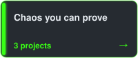
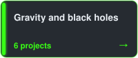
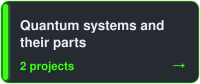
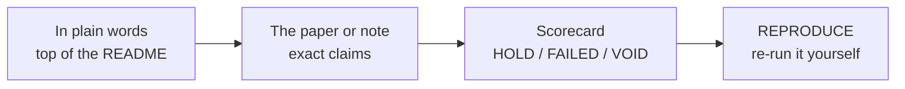

# Moki & Julio

**A small independent lab that proves, measures and checks things, from black holes to prime numbers to real devices.
Each project ships its code and data, and says plainly what was and was not shown.**

 

Six doors, fourteen projects. Click a door to jump to its projects.

Moki & Julio · text and data CC BY 4.0, code MIT, unless a repository says otherwise

## In plain words

We do computational research: proofs a computer can check, measurements of real devices, and very long, very precise
calculations. Each project below can be checked or re-run by anyone.

 **The idea in one picture.** A kitchen where every dish arrives with its recipe, the shopping list, and a note on what burned.
**Where the picture breaks.** Tasting a dish is not proving it. Some of our results are proofs that an independent checker
program verifies. Others are measurements of one device, or simulations. Each repository says which.

Two habits run through all of it. First, where we can, we write a prediction down and hash it **before** the answer
exists, and a separate seat computes the answer without seeing the prediction. Second, failures stay on the page, marked
FAILED, next to the results that held.

## Newest

**[certified-chen-lebrun-weber](https://github.com/Hashirama1337s/certified-chen-lebrun-weber)** (November 2026). The
Chen-LeBrun-Weber space is a solution of Einstein's equations of gravity that nobody can write down as a formula; it was
known to exist since 2008, but only as a theorem. We built an explicit computed version and proved, with every rounding
error counted, that the true space lies within about 5.5 parts in 100 million of it. As a consequence, its scalar
vibration spectrum has exactly one pitch below twice the cosmological constant. The proof is conditional on the cited
results listed in the paper, and the scorecard lists all 30 sealed tests, including the 16 that failed.
[doi:10.5281/zenodo.24188065](https://doi.org/10.5281/zenodo.24188065)

## The map of the lab

Pick the door that draws you. Each line is one project's plain hook; the repository climbs from there.

### Puzzles and shapes

- [**szilassi-12**](https://github.com/Hashirama1337s/szilassi-12) - Szilassi's polyhedron is a ring of seven hexagons in
  which every face touches every other. We proved that such a ring (without "overarching" faces) always has exactly one
  un-dented face, and that the
  next possible solid of this kind, with twelve faces, cannot have any symmetry. Each "impossible" comes with a proof file
  an independent checker reads.
- [**moki-julio-circle-packing**](https://github.com/Hashirama1337s/moki-julio-circle-packing) - How tightly can equal
  circles, spheres and higher-dimensional balls be packed? 6,071 record packings published, each verified by two
  independently written exact checkers; others have since beaten or tied 2,008 of them, and 4,063 were still best-known
  on 2026-10-18.

### Chaos you can prove

- [**ueda-chaos**](https://github.com/Hashirama1337s/ueda-chaos) - A damped spring with a cubic restoring force, pushed
  back and forth, x'' + 0.05x' + x^3 = 7.5 cos t: called chaotic for decades on the strength of simulations, now proved
  chaotic with two independently written rigorous checkers.
- [**rikitake-chaos**](https://github.com/Hashirama1337s/rikitake-chaos) - Two spinning copper discs, Rikitake's 1958
  model of a planet's magnetic field flipping, proved chaotic for three parameter values.
- [**laser-chaos**](https://github.com/Hashirama1337s/laser-chaos) - The CO2-laser chaos model (a loss-modulated
  class-B laser) provably contains a chaotic set of motions. In long simulations at the same parameters the laser settles
  into a rhythm that repeats every 16 modulation periods, so the chaos is real but hidden (the rhythm is a numerical
  observation, not proved).

### Gravity and black holes

- [**certified-chen-lebrun-weber**](https://github.com/Hashirama1337s/certified-chen-lebrun-weber) - A gravitational
  instanton that exists only as a theorem, now located by computer: an explicit approximation, and a proof that the true
  Einstein metric lies within about 5.5 parts in 100 million of it (conditional on cited results). Ships the code, the
  certified data, and every sealed test, failures included.
- [**large-d-gregory-laflamme**](https://github.com/Hashirama1337s/large-d-gregory-laflamme) - The exact recipe for when
  a stretched black hole (a black string) starts to break apart, pushed from five terms to thirteen. Those 13 exact terms
  plus 38 computed numerically (51 in all), summed the right way and read through a mathematical mirror, predicted how a
  hot holographic plasma screens a disturbance to about 9 and 15 digits at two untuned dimensions.
- [**airy-edge-hydrodynamics**](https://github.com/Hashirama1337s/airy-edge-hydrodynamics) - Fluid equations describe a
  holographic plasma only up to a certain momentum. Followed from three to 32768 dimensions, that limit creeps towards a
  fixed point as one over the cube root of d, with a coefficient from the Airy function (formal, no error bounds). A model
  built from it matched the computed values at d = 8192-32768; the repository explains why that test is not fully blind
  (the answers were already on disk), so it rests on the theory seat's word.

### Numbers and Ramanujan

- [**ramanujan-septic-galois**](https://github.com/Hashirama1337s/ramanujan-septic-galois) - On page 206 of his lost
  notebook Ramanujan left three pieces of a formula blank; Rebák filled them in in 2023. The same split exists at every
  odd prime; we found the pieces at 11 and 13, computed them for every prime below 100, and proved most of the rules that govern
  them.
- [**debruijn-newman-degree-two**](https://github.com/Hashirama1337s/debruijn-newman-degree-two) - Every L-function has a
  "heat dial" that pushes its zeros onto one line. We proved the dial never needs to go past 0.449938 for the modular
  form eta(z)eta(23z), where classical theory gives 1/2; we found no earlier bound below 1/2 in degree 2. Nothing here
  bears on the Riemann hypothesis itself.

### Quantum systems and their parts

- [**moment-map-local-maxima**](https://github.com/Hashirama1337s/moment-map-local-maxima) - A quantum system does not come
  with built-in parts. Which ways of splitting it make the parts interact least? For a simple spectrum, an exact
  classification with complete proofs, which also explains class counts McConnell and Jennings had computed numerically;
  degenerate spectra stay open.
- [**certified-qubit-peel**](https://github.com/Hashirama1337s/certified-qubit-peel) - A published method builds qubits
  out of a list of energies. Re-run with its authors' own notebook and checked against certified best splits: its first
  qubit scores about twice as badly as the best (+101 %), while its headline "of the order of a percent" holds up (2.88 %).

### Measuring real devices

- [**kinect-v1-depth-levels**](https://github.com/Hashirama1337s/kinect-v1-depth-levels) - Our Xbox 360 Kinect cannot
  report just any distance: between 1 and 4 metres it has exactly 259 possible answers, all on one published table. Also
  three kinds of noisy pixel, warm-up drift, and a map of what the hardware can and cannot do.
- [**moki-julio-wifi-ris-cell**](https://github.com/Hashirama1337s/moki-julio-wifi-ris-cell) - A "smart mirror" for
  Wi-Fi: one 15 mm cell whose single 1-bit switch state serves 2.4 GHz and the full 5.15-7.125 GHz span, meeting a 2 dB loss budget at every simulated angle but one, with the strict phase target met only in part. Simulation only;
  nothing has been built or measured.

## How to read any of our repositories

The status words mean the same thing everywhere.

| | Meaning |
|---|---|
|  | passed a bar written before the data (older pages print HOLDS) |
|  | did not pass, and stays on the page |
|   | the test could not decide |
|  | we withdrew it, and say why |

## Where to start

| If you want to... | Start here |
|---|---|
| re-run a certified computation of an Einstein metric | [certified-chen-lebrun-weber](https://github.com/Hashirama1337s/certified-chen-lebrun-weber) (Python + python-flint; the final check takes seconds) |
| check a computer-assisted proof yourself | [szilassi-12](https://github.com/Hashirama1337s/szilassi-12), [ueda-chaos](https://github.com/Hashirama1337s/ueda-chaos), [rikitake-chaos](https://github.com/Hashirama1337s/rikitake-chaos), [laser-chaos](https://github.com/Hashirama1337s/laser-chaos) |
| use record packings and their exact certificates | [moki-julio-circle-packing](https://github.com/Hashirama1337s/moki-julio-circle-packing) |
| compute a screening mass of the AdS black brane at your own d | [large-d-gregory-laflamme](https://github.com/Hashirama1337s/large-d-gregory-laflamme) (Python + mpmath, seconds) |
| test your own Kinect, or check its depth table without one | [kinect-v1-depth-levels](https://github.com/Hashirama1337s/kinect-v1-depth-levels) |
| read a plain index of every project (for search tools and AI assistants) | [llms.txt](llms.txt) |

Each repository lists its exact commands and expected outputs, and most carry a DOI so you can cite the version you used.

## What we do not claim

- Several proofs were checked by independent AI reviewers and **not yet by a human expert** (for example
  ramanujan-septic-galois and debruijn-newman-degree-two). That reading is the real bar, and we ask for it.
- "We found no earlier ..." is a search floor (a dated search of named sources), not a clearance.
- Records can fall: circle-packing lists every packing others have since beaten or tied.
- The Wi-Fi cell is a simulation study; the Kinect results are one unit, one operator.
- certified-chen-lebrun-weber is conditional on the results it cites (listed in its paper), one of them a preprint.

## Words you will meet

- **Computer-assisted proof** - a proof in which a computer does an exhaustive search or rigorously bounded arithmetic
  that anyone can re-run.
- **Independent checker** - a second, separately written program that verifies the same proof or certificate.
- **Certificate** - a file that lets a checker confirm a result without redoing the search.
- **Sealed test** - a prediction and pass bar hashed before the data exist.
- **Blind seat** - a separately briefed computation that cannot see the prediction it is scoring.
- **Search floor** - the dated list of sources we searched before saying something looked new.
- **DOI** - a permanent link to an archived, citable version.

## All projects

Newest first. Text and data are CC BY 4.0 and code is MIT unless a repository says otherwise.

| Project | Door | Archive |
|---|---|---|
| [certified-chen-lebrun-weber](https://github.com/Hashirama1337s/certified-chen-lebrun-weber) | Gravity and black holes | [doi:10.5281/zenodo.24188065](https://doi.org/10.5281/zenodo.24188065) |
| [airy-edge-hydrodynamics](https://github.com/Hashirama1337s/airy-edge-hydrodynamics) | Gravity and black holes | [doi:10.5281/zenodo.23942230](https://doi.org/10.5281/zenodo.23942230) |
| [large-d-gregory-laflamme](https://github.com/Hashirama1337s/large-d-gregory-laflamme) | Gravity and black holes | [doi:10.5281/zenodo.23940227](https://doi.org/10.5281/zenodo.23940227) |
| [debruijn-newman-degree-two](https://github.com/Hashirama1337s/debruijn-newman-degree-two) | Numbers and Ramanujan | [doi:10.5281/zenodo.23794431](https://doi.org/10.5281/zenodo.23794431) |
| [ramanujan-septic-galois](https://github.com/Hashirama1337s/ramanujan-septic-galois) | Numbers and Ramanujan | [doi:10.5281/zenodo.23790015](https://doi.org/10.5281/zenodo.23790015) |
| [laser-chaos](https://github.com/Hashirama1337s/laser-chaos) | Chaos you can prove | [doi:10.5281/zenodo.23422901](https://doi.org/10.5281/zenodo.23422901) |
| [certified-qubit-peel](https://github.com/Hashirama1337s/certified-qubit-peel) | Quantum systems and their parts | [doi:10.5281/zenodo.23293218](https://doi.org/10.5281/zenodo.23293218) |
| [moment-map-local-maxima](https://github.com/Hashirama1337s/moment-map-local-maxima) | Quantum systems and their parts | [doi:10.5281/zenodo.23275890](https://doi.org/10.5281/zenodo.23275890) |
| [ueda-chaos](https://github.com/Hashirama1337s/ueda-chaos) | Chaos you can prove | [doi:10.5281/zenodo.23172757](https://doi.org/10.5281/zenodo.23172757) |
| [moki-julio-wifi-ris-cell](https://github.com/Hashirama1337s/moki-julio-wifi-ris-cell) | Measuring real devices | [doi:10.5281/zenodo.23165406](https://doi.org/10.5281/zenodo.23165406) |
| [rikitake-chaos](https://github.com/Hashirama1337s/rikitake-chaos) | Chaos you can prove | [doi:10.5281/zenodo.23041182](https://doi.org/10.5281/zenodo.23041182) |
| [szilassi-12](https://github.com/Hashirama1337s/szilassi-12) | Puzzles and shapes | [doi:10.5281/zenodo.23003257](https://doi.org/10.5281/zenodo.23003257) |
| [moki-julio-circle-packing](https://github.com/Hashirama1337s/moki-julio-circle-packing) | Puzzles and shapes | [doi:10.5281/zenodo.22981305](https://doi.org/10.5281/zenodo.22981305) |
| [kinect-v1-depth-levels](https://github.com/Hashirama1337s/kinect-v1-depth-levels) | Measuring real devices | [doi:10.5281/zenodo.22984914](https://doi.org/10.5281/zenodo.22984914) |

---

*Prepared with AI assistance; what was checked, and by what, is stated above.*
